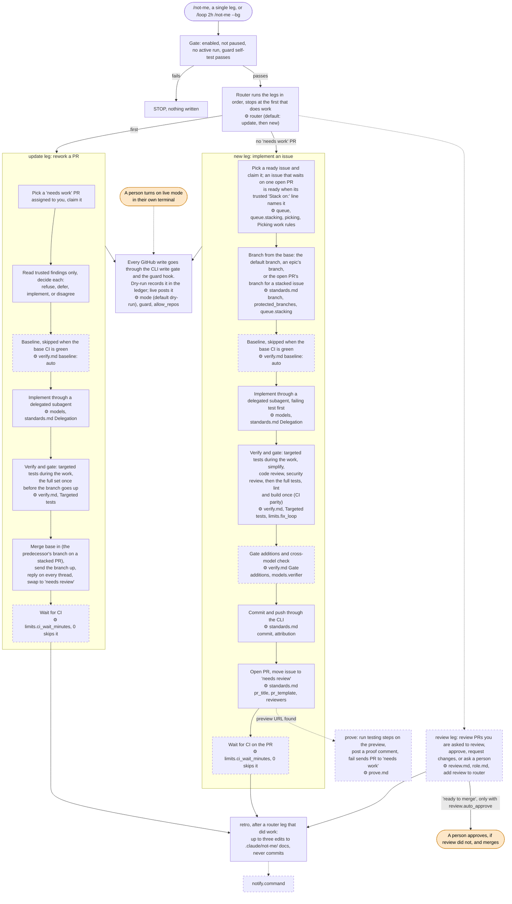

# not-me

not-me is a project-agnostic autonomous dev loop for Claude Code, shipped as a plugin and marketplace. It picks up ready GitHub issues, implements them, opens PRs, reworks PRs after review, reviews PRs, and proves PRs on a deploy target.

It is configured per repo by markdown docs in `.claude/not-me/` (layered: plugin defaults, then `~/.claude/not-me/`, then the repo). A stdlib-only Python CLI, `notme`, does all GitHub mechanics. A PreToolUse guard hook hard-blocks only what breaks the process or cannot be undone (commits, merges and pushes on protected branches, force-pushes, destructive git) and logs the rest, such as writes to other repos, for the skills to guide. Works in the Claude Code CLI and desktop.

## Quickstart

Install:

```
/plugin marketplace add dblanken-yale/not-me
/plugin install not-me@not-me
```

Then, in the repo you want to automate:

```
/not-me:doctor
/not-me:setup
/not-me --dry-run
```

`--dry-run` reads from GitHub for real and records every write in a ledger instead of posting it. Read the ledger and the run log, then run `/not-me:mode live` and follow its steps in your own terminal (a repo file can never set live, and a hand-edited `mode: live` stays dry-run). Then schedule it:

```
/loop 2h /not-me --bg
```

Other useful runs: `/not-me:new 42` to implement one issue, `/not-me:update owner/repo#57` to rework one PR, `/not-me:review --bg` to review the queue, `/not-me:status` to see what is waiting on a person.

Update with:

```
/plugin update not-me@not-me
```

## How a run works

Solid boxes always run. Dashed boxes are optional: they run only when you call them, configure them, or a condition holds. A `⚙` names the setting or config doc that changes the step (`project.md` keys unless another doc is named; see [Configuration](docs/config.md)). Rounded orange boxes are a person's job and nothing in not-me does them. Labels are shown by their default names. For the label state machine see [Workflow](docs/workflow.md).



## Commands

| Command | What it does |
| --- | --- |
| `/not-me [--dry-run] [--bg]` | Router: runs the legs in `router` order (default `update`, then `new`) and stops at the first that does work |
| `/not-me:new [issue#] [--base B] [--dry-run] [--bg]` | Pick up a ready issue, implement it through a delegated implementer, gate it, open a PR |
| `/not-me:update [PR ref] [--dry-run] [--bg]` | Decide each review finding on a `needs work` PR, fix, push, reply, swap to `needs review` |
| `/not-me:review [owner/repo#N ...] [--dry-run] [--bg]` | Review `needs review` PRs where you are a reviewer: approve, request changes, or ask a person. Never merges |
| `/not-me:prove <pr-ref> [--dry-run] [--bg]` | Run a PR's testing steps in a browser on its preview and post a proof comment |
| `/not-me:ticket [--check N] [--title T] [--parent N] [--dry-run]` | Create a ready issue, or check an existing one against the readiness rules |
| `/not-me:suggest [--dry-run]` | List ready issues nobody is assigned to, ranked by the picking rules, and assign the ones you pick to you. Run by a person, never by a loop |
| `/not-me:retro [log path] [--bg]` | Turn evidence in a finished run log into at most three small config edits |
| `/not-me:status` | Show state, the active run, items waiting on a person, stale claims, last results |
| `/not-me:setup [--global] [doc] [--check] [--upgrade] [--answers FILE]` | Guided setup of `.claude/not-me/`, or the global layer with `--global` |
| `/not-me:config [--layer default\|global\|repo]` | Explain the effective config and where each value came from |
| `/not-me:doctor` | Check tools, GitHub auth, config, the guard self-test and subagent depth |
| `/not-me:allow-repo <owner/name> [--everywhere]` | Show the allow list and print the command a person runs to change it (also `--board`, `--list`, `--remove`) |
| `/not-me:mode [dry-run [--global] \| live]` | Show dry-run or live and where it is set, switch to dry-run, or get the steps to go live in your own terminal |

## Requirements

git >= 2.30, gh >= 2.40, python3 >= 3.9.

## Repository layout

```
.claude-plugin/marketplace.json   marketplace listing
plugins/not-me/                   the plugin (skills, hooks, notme CLI, defaults, tests)
scripts/                          validation and test runners used by CI
docs/                             documentation
.github/                          CI, release, and contribution files
```

## Documentation

- [Requirements](docs/requirements.md)
- [Install](docs/install.md)
- [Configuration](docs/config.md)
- [Guards](docs/guards.md)
- [Workflow](docs/workflow.md)
- [CLI](docs/cli.md)
- [Testing](docs/testing.md)
- [Releases](docs/release.md)

## License

MIT. See [LICENSE](LICENSE).
