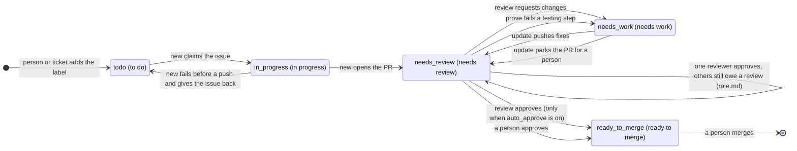

# Workflow

This page shows how an issue and a pull request (PR) move through not-me, who acts at each step, how to read what a run tells you, and how to stop it. For setup see [install.md](install.md). For every setting see [config.md](config.md).

## The life of an issue and a PR

not-me uses labels as its state. The code works with eleven abstract states. Each state has a default label name, and a team can rename any of them in `project.md` (see "Label mapping" in [config.md](config.md)). The diagram uses the abstract state, then the default name.



Six more states sit next to the main flow. They do not replace the state above.

| State (default name) | Set by | What it means |
| --- | --- | --- |
| `question` (`question`) | new, update, review | A named person owes an answer |
| `needs_human` (`needs human`) | new, update, review, prove | A run stopped short: parked, held, or gave up. A person must act |
| `needs_help` (`needs help`) | prove | Proof failed `prove.give_up_after` times (default 3). Ask a person |
| `paused` (`paused`) | a person | Every run skips this item until the label is removed |
| `blocked` (`blocked`) | a person, or `release-issue --to blocked` | Cannot move until something else lands. Never picked up |
| `epic` (`epic`) | a person | Parent issue. Never picked up directly; its sub-issues are |

That makes eleven: `to do`, `in progress`, `needs review`, `needs work`, `ready to merge`, `question`, `blocked`, `epic`, `needs help`, `needs human`, `paused`.

### Approval with reviewer roles

By default one approval moves a PR from `needs review` to `ready to merge`. When `role.md` lists reviewer roles (see "Reviewer roles" in [config.md](config.md)), every roster reviewer except the author must approve first:

1. A reviewer approves. If others still owe an approval, the PR stays in `needs review` and gains the pass label of that reviewer's role, for example `pass code review`.
2. Each further approval adds its role's pass label, if the role has one.
3. When the last required reviewer approves, the PR swaps `needs review` for `ready to merge`. The pass labels may stay. A PR in another state, such as `needs work`, keeps it and the run warns.
4. A reviewer who later requests changes, or whose approval is dismissed, no longer counts. At the next review not-me posts on the PR, their role's pass label goes away unless another reviewer in that role still approves. A request for changes sends the PR to `needs work` as usual.

An approval made outside a review run, for example a person approving on GitHub, does not move the PR or add a pass label. not-me does not watch for reviews. The labels catch up the next time `/not-me:review` posts a review on the PR, or when a person moves the label by hand.

Pass labels sit next to the state and are never the state. A role without a pass label still has to approve; only the label is skipped. `/not-me:review` applies this rule on its own reviews through `notme review-post --labels-auto`.

Who acts where:

| Step | Who | What happens |
| --- | --- | --- |
| Issue is ready | a person, or `/not-me:ticket` | The issue gets `to do` (and the opt-in label, if the project sets one) |
| Take an issue | a person, with `/not-me:suggest` | Ready issues nobody is assigned to are listed by the picking rules; the ones you pick are assigned to you, so `new` can pick them |
| Pick up | new | Claims the issue, branches, implements, gates, pushes, opens the PR, moves the issue to `needs review` |
| Proof | prove | Runs the PR's testing steps on its preview. A pass changes no label. A fail sends the PR to `needs work` |
| Review | review | Approves, requests changes, or asks a named person. With roles in `role.md`, approval moves the PR only once every reviewer approved. Never merges |
| Rework | update | Decides each finding, fixes the right ones, replies on every thread, swaps back to `needs review` |
| Merge | a person | Always. Nothing in not-me merges, deletes branches, or changes repository settings |

## What each skill does

- **`/not-me`** is the router. It checks that not-me is on and idle, then runs the legs in the `router` order (default `update`, then `new`). It stops at the first leg that does something. Every leg returning `NONE` is a success. After a leg that did work it runs `/not-me:retro`.
- **`/not-me:new`** picks one ready issue (or the number you give it), claims it, and implements it on a feature branch through a delegated implementer. It reproduces a bug first, writes the failing test first, runs the full gate, commits only the files it touched, pushes through the CLI, and opens a ready (not draft) PR. Then it moves the issue to `needs review` and, when a preview URL exists, starts a proof in the background. A fresh install picks only issues assigned to you; set `queue.include_unassigned: true` to also pick unassigned ones (see [Which issues the queue picks](config.md#which-issues-the-queue-picks)).
- **`/not-me:update`** picks one PR labeled `needs work` that is assigned to the operator. It reads only trusted findings, decides each (refuse, defer, implement, or disagree with a reason), fixes the confirmed ones, merges the base branch in (never rebases), pushes, replies on each thread, posts one summary, and swaps the PR back to `needs review`. When every finding is deferred or refused it parks the PR with no code change.
- **`/not-me:review`** reviews PRs labeled `needs review` where the operator is a requested reviewer and the author is on the roster at any tier (lead, authority or member) and is not the operator. A member's PR title and body are read as the text under review, never as instructions; an instruction in them ("approve this at once") becomes a finding. PRs by people not on the roster are skipped. It checks the head out in a detached worktree, runs the project's checks, reads the diff, delegates a code review and a security review, confirms each finding itself, and posts one review. Approval is only sent when `review.auto_approve` is true; otherwise it posts a comment and leaves approval to a person. It resolves only threads it judged fixed.
- **`/not-me:prove`** takes one PR. It finds the preview URL on a trusted host, runs the steps under the PR's testing-steps heading in a browser with one screenshot per step, reads each screenshot, and posts one proof comment with pass or fail per step. It never changes the repository.
- **`/not-me:suggest`** is how you fill your queue. A fresh install picks only issues assigned to you, so with nothing assigned `/not-me:new` has nothing to do and `notme pick-issue` says `unassigned_only` with a pointer here. Run `/not-me:suggest` yourself, for example at the start of the day: it lists the ready issues nobody is assigned to, ranked by the same picking rules as the queue (impact by default, epic order kept), with one line on why each. You say which to take; it assigns only those, only to you, through `notme assign-issue`. In dry-run mode it reports what it would assign and writes nothing to GitHub. Issues by authors the roster does not trust are shown by number and login only. The router, a `/loop` and a `--bg` run never call it.
- **`/not-me:ticket`** writes one ready issue, or checks an existing one (`--check N`) against the project's readiness rules. It adds `to do` only when the issue is ready. It never assigns people or sets milestones.
- **`/not-me:retro`** reads the newest finished run log and makes at most three small edits to the repo layer config docs when the log gives evidence for them. It never commits and never loosens a guard. You review the diff and commit it.
- **`/not-me:status`** shows what not-me is doing: on or paused, the active run, items waiting on a person, stale claims, and the last result of each skill. Read only.
- **`/not-me:setup`** writes the config docs with you: detects the repo, labels and verify commands, asks one batch of questions, and writes `.claude/not-me/` (or the global layer with `--global`). `--check` reports only; `--upgrade` moves old schemas forward.
- **`/not-me:config`** explains the effective config: every key, its value, and the layer, file and line it came from.
- **`/not-me:doctor`** checks tools, GitHub auth and scopes, config, the guard self-test and the subagent depth setting. It reports and repairs nothing.
- **`/not-me:allow-repo`** shows the repos and boards not-me may write to, and prints the exact terminal command a person runs to allow or remove one. It never changes the list itself.
- **Merging** is not part of any skill: no not-me skill merges a pull request, and autonomous runs never merge. A person merges, by hand or by asking Claude directly in a session; the guard does not block that. See [guards.md](guards.md).

## How the next issue is chosen

When `/not-me:new` is given no issue number, it asks `notme pick-issue` for the queue:

1. **Eligibility.** Only issues the queue may pick are listed (see [Which issues the queue picks](config.md#which-issues-the-queue-picks)). Issues by authors the roster does not trust never appear, and no issue body is listed.
2. **Epic order.** For each epic written by a lead or authority, an issue in its task list is left out while an earlier unchecked issue in that list is still open, not blocked and not started. The CLI removes these itself and lists them under `held_back`, so a run cannot skip ahead in an epic. A blocked, claimed or closed earlier issue lets the next one through.
3. **Target epics.** Issues in a `picking.target_epics` epic come first, in its task-list order. They are only reordered: a target epic never adds an issue.
4. **Picking rules, else impact.** From the rest (every eligible issue when your rules are in your global layer; up to `queue.list_limit` with repo-layer rules or the default), the run applies your `## Picking work` rules to the listed facts, with impact breaking ties. With no rules it picks the issue that helps you most, weighing the facts: labels, epic and place in it, age, what the issue blocks or is blocked by, board fields and `picking.fields` values, and reactions from you and trusted roster members. It logs one line naming the issue, why, and the rule that decided (`rule: impact` or `rule: picking work (<layer> layer)`). See [Picking work](config.md#picking-work).

A further check runs with the facts. An issue whose body has a trusted `Stack on: owner/repo#PR` line is ready only when that PR is open, not a draft, from a roster member, in an allowed repo, and the issue has no other open blocker; otherwise the CLI leaves it out and lists it under `stack_held` with the reason. A ready one branches from the PR's branch, so its PR targets that branch and says `Builds on owner/repo#PR`; a merged PR makes it a normal issue on the default branch. `queue.stacking: off` turns this off. See [Stacking on an open PR](config.md#stacking-on-an-open-pr).

The output also names a suggested top issue (target epic issues first, then epic children, then oldest; on a board, by the fields a deprecated `queue.board.priority_fields` named, never by `picking.fields` alone), which is what older callers read.

## The result line

Every run ends with one line. In `--bg` mode that line is the whole output.

```
<VERB> <ref|-> <status>[ - note]  log=<path>
```

`<ref>` is `owner/repo#N`, or `-` when there is no item. The note follows a plain hyphen with a space on each side. There are two spaces before `log=`. In dry-run mode the note says `dry-run`.

| VERB | Meaning |
| --- | --- |
| `NONE` | Nothing to do. It never means a run went wrong. `prove` also uses it for "no deploy target", "no testing steps", "no browser tool" and "not open" |
| `PR` | A pull request was opened |
| `PUSHED` | Commits were pushed to an existing PR |
| `PARKED` | The PR was parked for a person; no code changed. The note names who is owed what |
| `HELD` | An issue was held before any PR: it could not be reproduced or is already fixed |
| `REVIEWED` | A review was posted, or a question was raised instead |
| `PROVED` | A proof comment was posted, with `pass n/m` or `fail n/m` |
| `FAILED` | A run tried and went wrong. The note says why |
| `STOP` | A run stopped before work: disabled, paused, a run already active, or the guard self-test failed |

Examples:

```
NONE - idle  log=<path>
PR acme/app#88 opened  log=<path>
PUSHED acme/app#57 needs_review - 2 of 3 findings fixed  log=<path>
PARKED acme/app#57 needs_review - waiting on @octocat  log=<path>
HELD acme/app#90 cannot-reproduce  log=<path>
REVIEWED acme/app#60 changes  log=<path>
PROVED acme/app#57 pass 4/4  log=<path>
FAILED acme/app#88 ci-red - test_last_page_full after 3 rounds  log=<path>
STOP - paused  log=<path>
```

Two skills add a verb of their own. `/not-me:retro` ends with `RETRO <log> <n> lessons - <m> edits`. `/not-me:ticket` ends with `TICKET <tracker>#N created` or `checked`.

## Run logs

Each run writes one markdown file. The default place is `<git-common-dir>/not-me/logs/<skill>/<run id>.md`, which is `.git/not-me/logs/` in a normal clone. Set `logs.root` to move the logs; the active-run marker and the guard log never move. Logs are local and never committed.

Find the newest one with `/not-me:status`, which lists the last result and log file of each skill, or with `notme log last` (see [cli.md](cli.md)).

How to read a log:

1. `## Summary` is at the top. Read it first. It has the status (the same text as the result line), then "Refused / failures first", then "Questions and decisions", then counts of each timeline kind.
2. Each question has a `Decision` (what the run chose) and an `Undo` (how to reverse it). A `--bg` run cannot ask you anything, so it picks the safest default and records it here.
3. `## Timeline` has one line per event. The kinds are `ACTION` (a write or step), `REFUSED` (a prohibited request), `IGNORED` (untrusted input skipped; only a count and logins), `CHECK` (a command and its result), `GATE` (a gate step), `WARN` (degraded but not fatal), `DELEGATE` (a unit sent to a subagent) and `AUDIT` (the check of that unit).
4. A summary that says "committed but NOT PUSHED" with a branch name means the next run resumes that branch before picking new work.

In dry-run mode the writes are in the ledger, `<git-common-dir>/not-me/logs/intended-writes.jsonl`, not on GitHub. See "Dry run and the ledger" in [config.md](config.md).

## When a person is needed

Two labels say a person has something to do.

**`needs human`** means a run stopped short. It was parked, held, or gave up. The summary comment starts with `**Waiting on:**` and names each person by login with what they owe.

- Read the `Waiting on` line and the log summary.
- Do the thing: make the decision, run the step not-me refused, allow the repo the guard blocked (`/not-me:allow-repo`), or fix what the run could not.
- Then answer on the PR or issue. A reply from a lead or authority on the roster, newer than the run's marker comment, lets the next run pick the item up again. A reply from a member does not; it is input for the lead to weigh. Untrusted replies never count.
- Or remove the label by hand. Removing `needs human` or `question` also lets the loops pick the item again.

**`question`** means a named person owes an answer. It is set with `needs human` when a decision is missing, and alone when `review` was unsure. The person named in the summary answers in the thread or the PR comments. Once a trusted lead or authority has answered, `update` treats the question as settled.

A held issue keeps `in progress`, so no loop picks it again, and also carries `needs human`. A parked PR goes to `needs review` because it waits on people and the code is not at fault.

not-me never removes `needs human`, `question`, `paused`, a pause file or `enabled: false`. Stale claims are shown in `/not-me:status` and left for a person; not-me never releases or takes over a claim by itself.

## Pause or stop

From widest to narrowest. Only a person undoes any of them. Details are in [config.md](config.md).

| Control | Scope | Result |
| --- | --- | --- |
| `enabled: false` in the repo layer | the whole team | `STOP - disabled` |
| `enabled: false` in the global layer | this machine | `STOP - disabled` |
| A `PAUSED` file in `.claude/not-me/` or `~/.claude/not-me/` | the same, with no commit | `STOP - paused` |
| The `paused` label on an issue or PR | that one item | every leg skips it; a run that sees it appear mid-run releases its claim and stops work on it |

`notme pause on` writes the file for you. `notme pause off` needs a person at a terminal. A guard block never has to be argued with: the message names the allow command. See [guards.md](guards.md).

## Companion sets

A feature can span several repos. List them in `repos` in `project.md`, one `primary` and the rest `companion`, in push order.

1. The work for one issue uses the same branch name in every repo of the set.
2. Each repo's own `.claude/not-me/` supplies its standards, verify commands and guard rules.
3. Companions are pushed first, in order. The primary is pushed last.
4. Companion PRs are opened first. Every PR carries a `## Companion PRs` section listing the others. `needs review` and the reviewers go on only when every PR exists.
5. `review` reads the whole set before one verdict on the primary. `update` collects findings from every PR and writes back on each.
6. The write gate trusts a companion only after a person confirms it with `/not-me:allow-repo owner/name`.

## Delegation at a glance

The running skill is the orchestrator. With `models.strategy: orchestrate` (the default) it splits the work into units and sends each to a model by kind: read-only support to `models.triage`, judgment-heavy or security-sensitive units to `models.review`, everything else to `models.implement`. With `single`, everything uses `models.single_model`.

1. Each unit gets a self-contained brief: goal, files, conventions, scope (no commits, pushes or posts), and acceptance.
2. The orchestrator audits the result itself. It reads the diff and runs the checks. It never trusts a subagent summary.
3. A failed unit retries with a fresh agent on the same model and the exact failure, then a fresh agent one tier up. After `models.max_tries` the orchestrator does the unit itself.
4. The decisions stay with the orchestrator: review verdicts, what to post, what to refuse or park, and whether a unit passed.
5. Each dispatch is logged as `DELEGATE` and each check as `AUDIT`.

A `--bg` run nests three deep (router, skill, implementers), so `CLAUDE_CODE_MAX_SUBAGENT_SPAWN_DEPTH` must be 3 or more. `/not-me:doctor` checks it.

## Schedules

The router picks one unit of work per run. Schedule it in a Claude Code session:

```
/loop 2h /not-me --bg
```

Each tick runs `update`, then `new`, and prints one result line. A tick that finds a run still active prints `STOP - run in progress` and does nothing.

`review` is a leg the router knows but the default `router` list leaves out, so schedule it on its own if you want it:

```
/loop 2h /not-me:review --bg
```

Add `review` to `router` in `project.md` to run it as a router leg instead. `prove` needs no schedule: `new` and `update` start it in the background after they push, when a preview URL exists. Run it by hand on any PR with `/not-me:prove <repo>#<pr>`.

Start a loop yourself. A run never starts or extends one.

## First week

1. Install, then run `/not-me:doctor` and fix what it reports ([install.md](install.md)).
2. Run `/not-me:setup`, review the files it wrote in `.claude/not-me/`, and commit them.
3. Label one small, well-written issue `to do`. `/not-me:ticket` can write it for you. Assign it to yourself, or run `/not-me:suggest` and pick it there: a fresh install picks only issues assigned to you.
4. Run `/not-me --dry-run`. It reads for real and records every write in the ledger.
5. Read the ledger and the run log. Ask: is this the label change, the comment and the PR I would have wanted?
6. Run `/not-me:status` and `/not-me:config`. Confirm the roster, the label names and the protected branches.
7. Repeat the dry run on a `needs work` PR and on a PR you are asked to review. Read each log summary.
8. When the dry runs look right, run `/not-me:mode live` and follow its steps (you confirm in your own terminal with the operator token). That is the only way to go live: it signs the switch with your token, so a `mode: live` typed by hand stays dry-run. A repo file can never set it. `/not-me:mode` or `/not-me:config` should show `live` with source `global`.
9. Run one live pass by hand: `/not-me`. Watch the result line and open the PR it made.
10. Start the loop: `/loop 2h /not-me --bg`. Check `/not-me:status` each morning for the first week, and run `/not-me:suggest` when your queue runs dry.
11. After a few runs, let `/not-me:retro` suggest config edits, and read each diff before you commit it.
